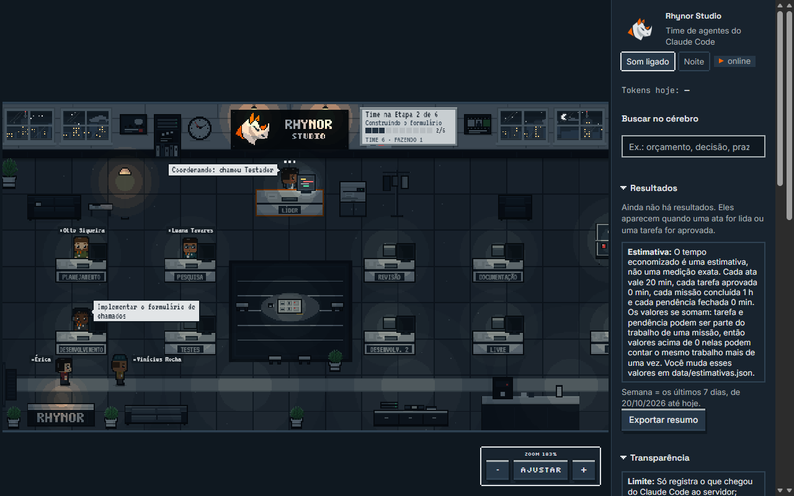

# AG Pocket

> Instalando em outro PC? Veja o [SETUP.md](SETUP.md).

Um escritório pixel art que mostra seu time de agentes do Claude Code trabalhando em tempo real. Cada agente é um **AGzinho**: um personagem com nome, uniforme da sua função e jeito próprio. Ele senta na própria mesa, digita quando está usando ferramenta, levanta um **!** quando precisa de você, manda envelopes pros colegas e, quando fica de boa, vai tomar café, jogar ping-pong ou bater papo.



```
Claude Code ──hooks──▶ servidor Node (Express) ──WebSocket──▶ tela React + canvas
```

## O que tem aqui

| Pasta | O que é |
|---|---|
| `agents/` | Os 6 subagentes do time ([[planejador]], [[pesquisador]], [[dev]], [[testador]], [[revisor]], [[documentador]]) |
| `team/CLAUDE-time.md` | Instruções pro Claude principal saber quando chamar cada um e montar a lista de tarefas ([[CLAUDE-time]]) |
| `team/CLAUDE-memoria.md` | Bloco de memória no Obsidian; o vault vem de `AGPOCKET_VAULT` e o setup instala ([[CLAUDE-memoria]]) |
| `hooks/hook.mjs` | O hook: pega cada evento do Claude Code e manda pro servidor |
| `server/` | Recebe os eventos, traduz em "quem está fazendo o quê", guarda o elenco e transmite |
| `shared/roster.ts` | Elenco padrão dos AGzinhos e as regras de validação (roda no servidor e no navegador) |
| `web/` | O escritório em si (React + canvas, tudo desenhado por código) |
| `web/src/theme.ts` | **Onde você personaliza** nome, logo, cores e uniformes |
| `web/src/office/map.ts` | Planta do escritório (posição das mesas, móveis) |
| `data/agzinhos.example.json` | Elenco de exemplo, versionado. O `data/agzinhos.json` real fica fora do git |
| `setup/skills.json` | Catálogo do que o `npm run setup` instala (essenciais e extras de terceiros) |
| `commands/` | Comandos `/time`, `/memoria` e `/reuniao` do Claude Code, copiados para `~/.claude/commands/` pelo setup |
| `vault-template/` | Modelo do vault do Obsidian (o "segundo cérebro"); o setup cria o vault a partir dele |
| `docs/power-automate-reunioes.md` | Formato da ata que um fluxo do Power Automate deve gravar no `00-Inbox/` (não testado) |
| `docs/exemplos/ata-ficticia.md` | Ata inventada, no formato do Power Automate, para testar a leitura automática |
| `scripts/setup.mjs` | O instalador (`npm run setup`, `npm run setup:check`); veja o [SETUP.md](SETUP.md) |

## Rodando (5 minutos)

Precisa de Node 20+ e do Claude Code instalado (e logado).

**Jeito rápido:** `npm run setup` faz tudo abaixo de uma vez (dependências, agentes, hooks, vault do Obsidian, comandos `/time`, `/memoria` e `/reuniao`, Playwright, plugins, build). Depois é só `npm start`. Opções e detalhes no [SETUP.md](SETUP.md); `npm run setup -- --dry-run` mostra o que ele faria sem escrever nada.

**Manual (alternativa):**

```bash
npm install

# 1. instala os 6 agentes em ~/.claude/agents (ficam disponíveis em todos os projetos)
npm run install-agents

# 2. liga os hooks em ~/.claude/settings.json (faz backup antes)
npm run install-hooks

# 3. sobe o escritório
npm run build
npm start          # abre em http://127.0.0.1:4747
```

O servidor escuta **só em `127.0.0.1`**: outras máquinas da rede não enxergam o escritório nem conseguem mandar eventos pra ele. A porta padrão é 4747 (mude com a variável `PORT`).

Agora abra uma sessão **nova** do Claude Code em qualquer projeto e peça algo. O líder aparece entrando pela porta e, quando ele delegar, os outros chegam.

Quer ver antes de ligar no Claude? Clique em **Rodar simulação** na tela.

### Fazendo o Claude usar o time
Rode `npm run setup` (instala o bloco de `team/CLAUDE-time.md` no seu `~/.claude/CLAUDE.md`, entre marcadores) ou copie o conteúdo à mão. Ou peça direto: *"usa o planejador pra quebrar isso e depois o dev implementa"*. Dentro do Claude Code, `/agents` lista os agentes instalados.

### Desenvolvendo o escritório
```bash
npm run dev        # servidor + Vite com hot reload em http://localhost:5173
```

> **Dica:** se o time estiver editando o próprio AG Pocket, rode o escritório com `npm run build && npm start` em vez de `npm run dev`. O `tsx watch` reinicia o servidor a cada mudança em `server/` ou `shared/`. Com a persistência ninguém some, mas o último ~1 s antes do reinício pode se perder.

### Desligando
```bash
npm run uninstall-hooks
```
Com o servidor desligado os hooks não atrapalham nada: eles rodam em segundo plano e ignoram o erro de conexão.

Só quer em um projeto específico? Use `npm run install-hooks -- --project C:\caminho\do\projeto` (e o mesmo para `install-agents`).

## Segundo cérebro (vault do Obsidian) e reuniões

O time tem uma **memória**: um vault do Obsidian com reuniões, missões, projetos, decisões e lições. As reuniões são a primeira porta de entrada vinda de fora: a ata vira nota e, **com o seu ok**, vira missão para o `/time`.

```
ata da reunião → /reuniao → nota em 10-Reunioes → você escolhe as tarefas → notas em 20-Missoes
→ /time executa → o painel mostra a missão e a reunião de origem → o documentador atualiza a memória
```

### Onde fica o vault

- **Fora do repositório.** O setup recusa um vault dentro da pasta do código.
- **Uma configuração só:** `AGPOCKET_VAULT` no `env` do `~/.claude/settings.json`. Agentes, comandos e servidor leem dali; nenhum arquivo do projeto tem caminho fixo.
- **O `npm run setup` cria o vault** a partir de `vault-template/` se a pasta ainda não existir, e só depois grava o `AGPOCKET_VAULT`. **Nunca sobrescreve um vault que já existe**: só confere a estrutura e avisa o que falta.
- **Onde ele cria:** o `AGPOCKET_VAULT` que já estiver no settings.json manda; senão, a flag `--vault=<pasta>` (caminho completo ou começando com `~`); senão, a pasta `AG-Cerebro` ao lado do repositório.
  ```bash
  npm run setup -- --vault=~/Documentos/AG-Cerebro
  ```
- Se uma pasta **acima** do vault novo já for um vault do Obsidian (tem `.obsidian/`), o setup avisa: os links `[[ ]]` podem ficar ambíguos até o vault antigo ser arquivado.
- **O servidor do AG Pocket** lê o caminho da variável `AGPOCKET_VAULT` do ambiente e, se ela estiver vazia, do `env` do `~/.claude/settings.json` (o `npm start` não herda o env do Claude Code).

### Estrutura

| Pasta | O que tem |
|---|---|
| `_indice.md` | Mapa curto do vault. Os agentes leem **este** primeiro |
| `00-Inbox/` | Entrada bruta: atas e ideias soltas. Atas processadas vão para `00-Inbox/processadas/` (nunca são apagadas) |
| `10-Reunioes/` | Uma nota por reunião (nasce confidencial) |
| `20-Missoes/` | Uma nota por missão: origem, tarefas, status, commits |
| `30-Projetos/` | Uma nota por projeto ou repositório: contexto, stack, decisões |
| `40-Conhecimento/` | Padrões, glossário, "como fazer X", lições reutilizáveis |
| `50-Time/` | Um card por agente e o mapa `AGENTES.canvas` |
| `90-Memoria-do-time/` | Sessões, Decisões, Lições aprendidas e Pendências |
| `Templates/` | Modelos: Reunião, Missão, Projeto, Sessão |

Toda nota tem o mesmo frontmatter, e as notas se ligam por `[[ ]]` (reunião, missão, projeto, sessão):

```yaml
---
tipo: missao          # reuniao, missao, ata, indice...
projeto: escritorio-ia
data: 2026-10-13
status: a fazer
origem: reuniao       # facilitator, power-automate, manual...
tags: [missao]
confidencial: false
---
```

### Regras de memória do time

O setup instala um bloco de memória (`team/CLAUDE-memoria.md`) no seu `~/.claude/CLAUDE.md`, entre os marcadores `<!-- ag-pocket:memoria:inicio -->` e `<!-- ag-pocket:memoria:fim -->`. Ele diz:

- **Começo de missão:** o líder lê `_indice.md`, depois **só** a nota do projeto em `30-Projetos/` e os itens de Decisões e Pendências ligados a ele. Nada de ler o vault inteiro.
- **Fim de missão:** o documentador atualiza a nota da missão (status, commits, o que mudou), a do projeto e a memória do time. Notas curtas, sem código nem logs.
- **Pesquisador:** consulta `40-Conhecimento/` antes de buscar na web e salva lá o que aprender de reutilizável.
- O líder passa o caminho do vault (`AGPOCKET_VAULT`) aos agentes que usam o vault.

### Comandos

| Comando | O que faz |
|---|---|
| `/memoria <pergunta>` | Responde **só** com base no vault, citando as notas como `[[nota]]`. Se não achar, diz "Não achei isso no vault" e não inventa. Não edita nada |
| `/reuniao` | Transforma uma ata (texto colado ou arquivo de `00-Inbox/`) em nota de reunião e, com o seu ok, em missões |
| `/time <tarefa>` | Roda a tarefa com o time. Se citar uma missão (`Missão [[nota]]`), ela vai para `em andamento` e o documentador marca `concluída` no fim |

**Leitura automática, sem IA (a ata chega e a nota nasce sozinha).** Com o servidor ligado, toda ata `.md` que cair na **raiz** de `00-Inbox/` é lida pelo próprio AG Pocket, **sem chamar o Claude**: ele espera o arquivo ficar quieto (~2 s), extrai título, data, notas, decisões e tarefas (com responsável e prazo, quando tiver), grava a nota em `10-Reunioes/` e move a ata bruta para `00-Inbox/processadas/` (nunca apaga). A nota nasce `confidencial: true`, com `origem: leitura-automatica` e `processamento: sem-ia`, e os nomes de responsáveis e de quem falava viram "Responsável A, B..." (o nome original fica só na ata bruta arquivada). Rodar de novo não duplica (a nota é achada pelo `reuniao_id`). Ata **fora do formato** (transcrição, sem frontmatter fechado, sem seções) não é tocada: fica no Inbox e o painel mostra "precisa do /reuniao". `AGPOCKET_INGESTAO=0` desliga a leitura automática, mas só vale no shell que sobe o servidor: o servidor não herda o env do `settings.json` do Claude (só o caminho do vault é lido de lá). Ao subir, atas boas que já estavam no Inbox são lidas e arquivadas na hora, sem o aviso `ata-nova` (que só sai para atas que chegam com o servidor ligado, e sem o título da reunião). A mesma ata (mesma `fonte` com o mesmo `fonte_hash`, ou mesmo `reuniao_id`) não vira duas notas. O formato da ata está em [docs/power-automate-reunioes.md](docs/power-automate-reunioes.md).

**Atas fictícias para testar e apresentar:** `npm run ata-ficticia` grava uma ata inventada em `00-Inbox/` do vault configurado. Opções (depois de `--`): `--cenario=<nome>` (`projeto-software`, `alinhamento-bi`, `so-decisoes`, `tarefas-sem-prazo` ou `bagunçado`, também aceito como `baguncado`; sem a opção sai um aleatório), `--vault=<caminho>` e `--sem-gravar` (só mostra o texto). O cenário `bagunçado` é uma transcrição de propósito: ele fica no Inbox esperando o `/reuniao`.

**O `/reuniao`, passo a passo** (usado quando a ata veio fora do formato, ou quando você cola o texto; com a ata inventada de `docs/exemplos/ata-ficticia.md`):

1. Copie a ata para `<vault>/00-Inbox/ata-2026-10-13-1900-clube-de-leitura.md` (ou cole o texto direto no comando).
2. No Claude Code, rode `/reuniao ata-2026-10-13-1900-clube-de-leitura.md`. Sem argumento, ele lista as atas com `status: nova` e pergunta qual usar.
3. Ele cria a nota em `10-Reunioes/AAAA-MM-DD-<titulo>.md` com `confidencial: true`, trocando nomes de pessoas por papéis ("voluntário de TI").
4. Mostra as tarefas classificadas: 🤖 o time pode fazer, 🙋 precisa de humano, ❓ não está claro. Na ata fictícia, o esperado é 🤖 1, 2 e 3; 🙋 4 e 5; ❓ 6.
5. **Pergunta quais viram missão** e de qual projeto (ex.: `1,3`). Nunca começa nada sozinho: só escreve notas.
6. Cria uma nota por missão em `20-Missoes/` (`status: a fazer`, link para a reunião e o projeto) e **sugere**, sem rodar, o comando pronto, algo como (nome ilustrativo: o nome real sai do título que o comando gerar, e o dia vem da ata):
   ```
   /time Missão [[2026-10-13-pagina-de-inscricao]]: criar a página de inscrição. Projeto: <projeto>
   ```
7. A ata do Inbox ganha `status: processada` e vai para `00-Inbox/processadas/`.

Quando você roda o `/time` sugerido, a missão passa de `a fazer` para `em andamento` e, no fim, o documentador marca `concluída` e preenche o resultado (commits, o que mudou, sessão).

### No painel e no escritório

- **Seção "Missões"** (recolhível) no painel: nome, status (a fazer / em andamento / concluída), barra de progresso quando a missão tem lista de tarefas e "📋 da reunião X". Clicar mostra o resumo da missão.
  - **Duas abas dentro da seção:** **Abertas · N** (a fazer + em andamento) e **Concluídas · N**. O título "Missões · N" conta só as abertas. O navegador lembra a aba escolhida; dá para trocar pelo teclado (setas, Home, End). Sem nenhuma missão, as abas não aparecem; cada aba tem o próprio aviso de vazio.
  - **Na aba Concluídas** cada item mostra "Nota de dd/mm/aaaa": é a **data da nota**, não a data de conclusão (essa ainda não é gravada em lugar nenhum).
  - **Limite:** o painel mostra até **50 abertas e 50 concluídas**, as mais recentes primeiro (pela data da nota ou, sem ela, pela última alteração). As contagens das abas são os totais de verdade; quando há corte aparece "Mostrando as 50 mais recentes de N".
- **Faixa "Chegou uma ata nova: rode /reuniao"** (com mais de uma, "Chegaram n atas novas"): aparece quando cai uma ata nova na raiz de `00-Inbox/` e some depois que ela é processada (em até ~30 s). Com a leitura automática ligada, a ata boa é lida sozinha e some; a faixa passa a dizer "precisa do /reuniao" só para as que vieram fora do formato.
- O resumo da missão, ao clicar, mostra o objetivo e as tarefas.
- **Reunião no escritório:** quando você roda `/reuniao`, os AGzinhos **livres** vão para a mesa de reunião e sentam em volta da maquete, e o líder fica de pé "apresentando" enquanto o comando roda. Depois todos voltam. Quem está trabalhando não sai da mesa.
- **Quadro da parede:** mostra o nome da missão atual quando ela veio de uma reunião.
- **Caixa de entrada** (no topo do painel, só aparece quando há reunião para decidir): cada reunião lida sem IA (`status: rascunho`) aparece com o título, a data e as tarefas em aberto (responsável e prazo).
  - Para cada tarefa você escolhe **🤖 Time faz**, **🙋 Eu faço** ou **🗑️ Ignorar** (botões com texto, que também funcionam pelo teclado). **Aprovar** só habilita quando todas têm escolha. Reunião sem tarefas mostra "sem tarefas" e o botão **Arquivar**.
  - Ao aprovar, o servidor grava a escolha na linha de cada tarefa da nota (`classe: time` ou `classe: eu`; ignorar vira `- [-]`), cria **uma única missão** em `20-Missoes/` com todas as tarefas "Time faz" (como `- [ ] texto | prazo: AAAA-MM-DD`), preenche "## Missões geradas" e muda a reunião para `status: processada`. Sem nenhuma tarefa "Time faz" não nasce missão.
  - O painel mostra o **comando pronto** (`/time Missão [[nota]]: Fazer as N tarefas da reunião ...`) com o botão **Copiar comando** (aviso "Copiado!"). **O painel nunca roda o Claude**: quem cola e executa o comando é você, no terminal. Reiniciar o servidor mantém a lista (ela vem das notas do vault). Aprovar duas vezes a mesma reunião é recusado (409).
  - As tarefas "Eu faço" ficam na nota (`classe: eu`); elas aparecem na seção **Pendências** do painel (veja abaixo).
  - **Limite de 40 tarefas:** o painel mostra as 40 primeiras tarefas em aberto (com o aviso "Mostrando as 40 primeiras tarefas; as demais ficam na nota") e o servidor só exige decisão sobre elas. As demais ficam intocadas na nota (`classe: ?`).
  - **A aprovação é a sua revisão.** A missão nasce com `confidencial: false` e com o texto da tarefa como está na nota, sem passar por filtro. Os nomes trocados por "Responsável A" só valem onde a leitura automática os reconheceu: **nomes residuais podem sobrar no texto**, então leia as tarefas antes de aprovar. Crases no título, projeto e tarefas viram aspa simples na missão (para não quebrar o bloco do "Comando sugerido").
  - **Conferência da nota:** as escolhas vão por número da tarefa, junto com um hash curto do texto dela. Se a nota foi editada depois que o painel carregou (texto diferente, ou arquivo alterado durante a aprovação), o servidor responde `409` "A nota mudou, tente de novo", desfaz a missão criada e não sobrescreve a sua edição.
  - **Segurança local:** o WebSocket recusa `Origin` de outro site (sem `Origin`, como num script local, passa) e `GET /api/caixa` recusa `Host` que não seja `127.0.0.1:PORTA` ou `localhost:PORTA`. No `npm run dev` o proxy do Vite ajusta o `Origin` só quando ele é o do próprio painel (porta 5173).
- **Pendências** (no painel, abaixo da Caixa de entrada): as tarefas em aberto com prazo, vindas de duas fontes.
  - **Reunião** (`10-Reunioes/`): só as linhas `- [ ]` com `classe: eu` (as que ficaram com você). As de `classe: time` já estão na missão da reunião e as de `classe: ?` ainda esperam a Caixa de entrada, então nada aparece duas vezes. A reunião com `classe: eu` entra **mesmo com `confidencial: true`**, mas o painel mostra só título da nota, texto, responsável e prazo da tarefa (pauta, decisões, dúvidas e transcrição nunca saem do servidor).
  - **Missão** (`20-Missoes/`, que não esteja concluída nem confidencial): todas as linhas `- [ ]` da seção `## Tarefas`. O dono é o time; missão criada pelo `/reuniao` com `classe: humano` ou `duvida` fica com você.
  - Cada item mostra o texto, o responsável, o prazo (dd/mm/aaaa), a origem (título da reunião ou da missão), de quem é e o estado, com o selo: **🔴 Atrasada** (prazo antes de hoje), **🟠 Vence em até 2 dias** (de hoje até hoje + 2, em âmbar escuro sobre fundo claro; o laranja vivo é só de "te esperando") ou **⚪ Sem prazo**. O selo sempre traz ícone **e** texto. Prazo inválido (como 2026-02-31) conta como sem prazo.
  - Filtros **Minhas**, **Do time** e **Atrasadas** (o escolhido fica lembrado no navegador). O botão **Concluir** marca a tarefa na nota (`- [x] ... | concluída: AAAA-MM-DD`) e o foco vai para o próximo item. Quando a tarefa concluída era a **última em aberto** de uma missão (linhas `- [-]` ignoradas não seguram), a mesma gravação põe `status: concluída` e `concluida_em: AAAA-MM-DD` no cabeçalho da missão (CRLF e BOM mantidos, com as mesmas conferências da nota); a resposta traz `missaoConcluida: true`. Missão concluída sai das Pendências e entra nos Resultados. Só muda o status quem estava vazio, `a fazer`, `aprovada` ou `em andamento`; missão `cancelada`, `pausada` ou com outro status fica como está (a tarefa é marcada, mas a resposta não traz `missaoConcluida`). **Reabrir uma tarefa no Obsidian não reabre a missão**: o `status` continua `concluída` até você mudá-lo na nota.
  - **No escritório:** com pelo menos uma pendência atrasada, um AGzinho do time que está de boa segura uma plaquinha pequena de aviso (quadrado vermelho com "!"), sempre desenhada por cima das mesas e monitores; ela some quando não há mais atrasadas e fica parada se o sistema pede menos movimento (`prefers-reduced-motion`).
  - **Limitação:** a tabela de `## Tarefas` que o `/reuniao` escreve (colunas com `|`, sem caixinha) **não entra**: só linhas `- [ ] texto | responsável: ... | prazo: AAAA-MM-DD`. Notas com nome fora de letras, números, espaço, hífen e sublinhado também ficam de fora. O painel mostra até 100 pendências. O painel nunca roda o Claude.
- **Resultados** (no painel, abaixo das Pendências, mais um resumo de hoje perto do quadro de etapas): quanto o AG Pocket já ajudou, **contado das notas do vault** (a fonte da verdade: apagar uma nota derruba o número, reiniciar o servidor não muda nada; não existe contador solto em memória). Mostra **hoje**, **semana** (os últimos 7 dias corridos, contando hoje) e **total** de:
  - **Atas processadas**, separadas em **lidas sem IA** (`processamento: sem-ia`, a leitura automática; data = `processada_em`) e **com IA** (`/reuniao`, `origem: facilitator`; reunião escrita à mão, sem esse marcador nem o da leitura automática, **não conta** como ata nem soma minutos; data = `data` da reunião).
  - **Tarefas aprovadas**: as tarefas das missões criadas na aprovação da Caixa (`aprovada_em`). A tarefa "Time faz" existe na reunião e na missão, mas conta **uma vez só**; "Eu faço" e ignoradas não entram aqui.
  - **Missões concluídas** (`status: concluída`; data = `concluida_em`, gravado pela conclusão automática; sem ele a missão entra **só no total** (a data do arquivo não vale) e o painel avisa "data aproximada" (reabrir uma tarefa no Obsidian não reabre a missão: o status continua `concluída`)) e **pendências fechadas** (`- [x] ... | concluída: AAAA-MM-DD`).
  - **Tempo economizado**, sempre rotulado **(estimativa)** e com a frase "O tempo economizado é uma estimativa, não uma medição exata." à vista (nunca só numa dica): é contagem × minutos de cada tipo. Nota sem data só entra no total; nota de demonstração (`ficticia: true`) conta e o painel avisa.
  - **Minutos configuráveis** em `data/estimativas.json` (fora do git; copie `data/estimativas.example.json`): `ataProcessada` (20), `tarefaAprovada` (0), `missaoConcluida` (60) e `pendenciaFechada` (0). Vale sem reiniciar (o servidor confere o arquivo a cada recálculo). Valor negativo, texto ou acima de 10000 é recusado: usa o padrão daquele item e avisa no log. Uma missão concluída tem uma chave só (não há minutos por tipo de missão), e **os valores somam**: a mesma tarefa pode contar como aprovada, como pendência fechada e dentro da missão concluída. Por isso tarefa e pendência vêm em **0** por padrão (sem dupla contagem); valores acima de 0 nelas podem contar o mesmo trabalho mais de uma vez.
  - **Exportar resumo**: gera um `.md` simples (números, período, minutos usados e a frase da estimativa), mostra o texto no painel com **Copiar** e **Baixar**, e guarda uma cópia em `data/exportacoes/resultados-AAAA-MM-DD.md` (fora do git; no mesmo dia o arquivo é substituído).
  - Passando de 5000 notas por pasta, o servidor avisa no log e conta só as primeiras 5000. O painel só lê e exporta: **nunca roda o Claude**, e só números saem do servidor (nenhum título nem texto de nota). O servidor reabre só as notas que mudaram (cache por data e tamanho) e lê no máximo 5000 notas por pasta.
- **Ata nova no escritório:** quando a leitura automática lê uma ata, os AGzinhos livres sentam na mesa de reunião por ~12 segundos e o quadro da parede mostra "Nova ata" (sem o título, de propósito). Não substitui uma reunião de verdade (`/reuniao`) em andamento, e se houver uma missão real em andamento o quadro continua mostrando a missão.

Por dentro: `GET /api/missoes` devolve as missões (status, origem, projeto, tarefas; até 50 abertas + 50 concluídas), os totais de cada grupo antes do corte (campo opcional `totais`, só contagens) e a contagem de atas novas (`inbox.novas`) e das fora do formato (`inbox.foraDoFormato`, opcional); o WebSocket ganhou as mensagens `missoes` (as missões ou a contagem mudaram), `reuniao` (uma reunião começou ou acabou) e `caixa` (a Caixa de entrada mudou: reuniões com título, data e tarefas) e `ata-nova` (a leitura automática acabou de ler uma ata: só texto fixo e hora; o painel usa para a animação).

Endpoints da Caixa de entrada:

| Rota | O que faz |
|---|---|
| `GET /api/caixa` | `{ itens: [{ id, titulo, data, tarefas: [{ n, texto, responsavel, prazo }] }] }` com as reuniões `status: rascunho` e `origem: leitura-automatica` de `10-Reunioes/`. Pauta, decisões e dúvidas nunca saem do servidor |
| `POST /api/caixa/aprovar` | Corpo `{ "reuniao": "<nota sem .md>", "decisoes": [{ "n": 1, "acao": "time" ou "eu" ou "ignorar", "h": "<hash de 8 hex, opcional>" }] }` com **todas** as tarefas mostradas (no máximo 40). `h` vem do `GET` e, se não bater com o texto atual da tarefa, dá `409`. Responde `{ ok, comando, missao }` (os dois são `null` sem tarefa "Time faz"). Erros: `400` pedido inválido, `404` reunião não encontrada, `409` já aprovada, `403` origem recusada, `415` não é JSON |

Endpoints das Pendências:

| Rota | O que faz |
|---|---|
| `GET /api/pendencias` | `{ itens: [{ id, h, texto, responsavel, prazo, origem, dono, status, urgencia }] }` (`dono`: `eu` ou `time`; `urgencia`: `atrasada`, `logo`, `no-prazo` ou `sem-prazo`, pelo dia local do servidor). Recusa `Host` de fora. O WebSocket manda `{ type: "pendencias", itens }` |
| `POST /api/pendencias/concluir` | Corpo `{ "id": "r:<nota>:<n>:<hash>" ou "m:...", "h": "<hash de 8 hex da linha>" }` (os dois vêm do `GET`). Marca `- [x]` e acrescenta `| concluída: AAAA-MM-DD` à linha, mantendo CRLF e BOM. Responde `{ ok, concluidaEm }`. Erros: `400` pedido inválido, `404` nota não encontrada, `409` a linha ou o arquivo mudou (nada é gravado), `403`/`415` origem recusada ou não é JSON |

Endpoints dos Resultados:

| Rota | O que faz |
|---|---|
| `GET /api/resultados` | `{ resultados: { hoje, semanaDesde, atas, atasSemIa, atasComIa, tarefasAprovadas, missoesConcluidas, pendenciasFechadas, tempoEconomizado (minutos), estimativas, missoesDataAproximada, semData, ficticias, incluiFicticias } }`, cada contagem como `{ hoje, semana, total }`. Recusa `Host` de fora. O WebSocket manda `{ type: "resultados", resultados }` quando as notas mudam |
| `POST /api/resultados/exportar` | Corpo `{}`. Grava `data/exportacoes/resultados-AAAA-MM-DD.md` e responde `{ ok, arquivo, texto }`. Erros: `403`/`415` origem recusada ou não é JSON, `500` não deu para gravar |

**Transparência** ("o que foi enviado ao Claude", no painel, abaixo dos Resultados): mostra **quais arquivos do vault os agentes abriram**, para você conferir que nota confidencial não foi lida. O servidor olha cada evento `PreToolUse` dos hooks (os hooks já cobrem todas as ferramentas, não precisa reinstalar) e, quando a ferramenta é `Read`, `Write`, `Edit`, `MultiEdit` (`file_path`) ou `Grep`/`Glob` (`path`, ou a pasta do projeto se faltar) **dentro do vault**, grava uma linha. Fora do vault, ignora. O caminho é resolvido antes de comparar (barra invertida, `..`, maiúsculas no Windows, caminho relativo à pasta do projeto e atalhos de pasta).
  - **Nunca grava conteúdo**: a linha tem só `ts, sessao, agente, ferramenta, acao, arquivo (relativo ao vault), confidencial, missao, via, nivel`. Nada do arquivo, nada do padrão buscado do `Grep`, nada de `tool_response` (o `PostToolUse` nem é olhado).
  - **Confidencial** = `confidencial: true` no começo da nota (primeiros 4 KB), qualquer coisa em `10-Reunioes/` ou em `00-Inbox/` (menos o `LEIA-ME.md`).
  - **Níveis (sempre ícone + texto, nunca só cor):** **ATENÇÃO** (vermelho) = agente leu nota confidencial fora do `/reuniao`, leu qualquer coisa de `10-Reunioes/` (mesmo durante o `/reuniao`), ou buscou (`Grep`/`Glob`) em lugar confidencial; **Esperado** (âmbar) = o `/reuniao` da própria sessão abriu a ata do Inbox, que é a exceção prevista; o resto é normal. Escrever ou editar uma nota confidencial é registrado como normal (com `confidencial: true`).
  - A faixa vermelha "ATENÇÃO: um agente leu uma nota confidencial" fica no painel enquanto o mês tiver ocorrência; a seção mostra também as **atas sem IA** e **com IA (/reuniao)**, contadas pela varredura de Resultados.
  - **Onde fica o log:** `data/transparencia/AAAA-MM.jsonl` (um arquivo por mês, só acrescenta; a pasta `data/` fica fora do git). O botão **Exportar** grava `data/transparencia/AAAA-MM.md` e mostra o texto para copiar ou baixar. Se a gravação falhar, o servidor só avisa no log dele; os hooks e a fila de eventos não são atrasados nem quebram.
  - **Limite honesto (aparece sempre no painel):** só registra o que chegou do Claude Code ao servidor. **Leituras feitas por comandos de shell (`cat`, `type`, `Get-Content`) não são vistas**, nem o que acontece com hooks desligados ou com o servidor fora do ar. É um registro de conferência, não uma garantia de que nada foi lido.

| Rota | O que faz |
|---|---|
| `GET /api/transparencia?mes=AAAA-MM` | Sem `mes`, o mês de agora (outro valor que não seja `AAAA-MM` dá `400`). Devolve `{ ok, mes, linhas (as últimas 100), contagens: { total, normais, informativos, violacoes, porAcao }, alerta: { violacao, violacoes, ultima }, atas: { semIa, comIa } (do mês), nota }`. Recusa `Host` de fora. O WebSocket manda `{ type: "transparencia", resumo }` (contagens do mês e as 20 últimas linhas), no máximo uma vez por segundo; uma violação sai na hora |
| `POST /api/transparencia/exportar` | Corpo `{}` ou `{ "mes": "AAAA-MM" }`. Grava `data/transparencia/AAAA-MM.md` e responde `{ ok, arquivo, texto }`. Erros: `400` mês inválido, `403`/`415` origem recusada ou não é JSON, `500` não deu para gravar |

**Segurança dos POST que gravam no vault** (vale para este e para os próximos): o servidor só ouve `127.0.0.1`, mas qualquer página aberta no navegador poderia mandar um POST para ele. Por isso o middleware `exigirPostSeguro` (`server/seguranca.ts`) exige `Content-Type: application/json` e, se o pedido trouxer `Origin`, ele tem que ser `http://127.0.0.1:PORT` ou `http://localhost:PORT` (curl e scripts locais, que não mandam `Origin`, passam). O id da reunião é validado por `^[0-9A-Za-z-]+$` (nunca um caminho), os arquivos só são montados dentro de `10-Reunioes/` e `20-Missoes/`, a missão é gravada com `wx` (nunca sobrescreve), a nota é regravada de forma atômica mantendo CRLF e BOM, e as aprovações rodam uma de cada vez. O id de uma pendência também nunca é caminho: `r` ou `m`, nome da nota (sem barra, ponto nem ":"), posição e hash, e a nota só é regravada se o hash da linha e a data do arquivo ainda forem os que o painel viu. No `npm run dev` o proxy do Vite troca o `Origin` (porta 5173) pelo do servidor, para o POST funcionar.

### Privacidade

- Nota com `confidencial: true` **não é lida** pelos agentes nem pelo painel (só o título pode aparecer no índice).
- Toda nota de reunião **nasce confidencial**; só mude para `false` depois de conferir que não há nada sensível.
- O painel recebe só o necessário: título neutro da reunião, dados da missão, a **contagem** de atas novas e, na Caixa de entrada, o título, a data e as tarefas (texto, "Responsável A", prazo) das reuniões que esperam aprovação, e nas Pendências o texto, o responsável, o prazo e o título de cada tarefa em aberto (reuniões: só as suas, `classe: eu`). Pauta, decisões e dúvidas das notas nunca vão para o painel, e o aviso "Nova ata" no escritório não leva o título.
- A **leitura automática** roda no servidor local (`127.0.0.1`) e, para isso, lê a ata do Inbox e grava em `10-Reunioes/` (de lá lê só o título, a data, o frontmatter e a seção Tarefas, para não duplicar). Tudo **sem IA**: nenhum conteúdo de reunião vai para o Claude antes da sua aprovação. Nomes que não eram responsáveis nem falantes podem ficar no texto das notas: cada nota traz o aviso para revisar.
- O `/reuniao` troca nomes de pessoas por papéis ou áreas. Mesmo assim, **revise a nota gerada**.
- Nunca guarde senha, token, chave ou dado pessoal no vault.
- `AGPOCKET_GRAVAR=1` (desligado por padrão) grava o prompt cru em `data/eventos/`, **inclusive a ata colada no `/reuniao`**. Veja "Gravador de eventos".
- Conteúdo de reunião em IA precisa de **aprovação da TI/governança** antes do uso com dados reais.

### Power Automate (próximo passo)

A ideia é um fluxo do Power Automate gravar o resumo do Facilitator do Teams direto no `00-Inbox/`. O formato exato do arquivo, as recomendações e o que conferir com a TI estão em [docs/power-automate-reunioes.md](docs/power-automate-reunioes.md). **O fluxo não existe e nada disso foi testado** com Power Automate real.

## Os AGzinhos

Cada agente do Claude Code vira um AGzinho do **elenco fixo**. O elenco padrão tem 12 pessoas (`DEFAULT_ROSTER` em `shared/roster.ts`). Todos os nomes são **fictícios**: qualquer semelhança com gente de verdade é coincidência.

| Nome | Apelido | Papel | Roupa | Acessório |
|---|---|---|---|---|
| Augusto Vilela | GUTO | Líder | terno + gravata dourada | relógio |
| Marina Toledo | MARINA | Planejadora | blazer marinho | prancheta |
| Caio Nogueira | CAIO | Pesquisador | polo marinho | óculos |
| Beatriz Lima | BIA | Desenvolvedora | camisa branca | headset |
| Rafael Mendes | RAFA | Testador | polo marinho | relógio |
| Lúcia Ferraz | LÚCIA | Revisora | blazer cinza | óculos |
| Davi Sampaio | DAVI | Documentador | camisa branca | lápis e barba |
| Yasmin Okada | YASMIN | Desenvolvedora (Dev 2) | polo marinho | headset |
| Tomás Ribeiro | TOMÁS | Pesquisador (Pesquisa 2) | camisa branca | prancheta |
| Iara Campos | IARA | Exploradora (convidada) | polo marinho + crachá de visitante | capacete branco |
| Jorge Batista | JORGE | Generalista (convidado) | camisa branca + crachá de visitante | colete |
| Sofia Arruda | SOFIA | Consultora (convidada) | polo marinho + crachá de visitante | caneca |

Como a escalação funciona:
- **O mesmo papel volta como a mesma pessoa.** Toda vez que o `dev` aparece, é a Bia; o `revisor` é sempre a Lúcia, em qualquer sessão. O mesmo agente chamado de novo volta **à mesma mesa**.
- **Cada evento mexe só no AGzinho do próprio `agent_id`.** Um subagente nunca "puxa" o estado de outro.
- **Trabalho em paralelo ganha variação.** Se dois devs (ou dois pesquisadores) trabalham ao mesmo tempo, o segundo é a Yasmin (Dev 2) e o Tomás (Pesquisa 2), com visual próprio, em vez de um clone.
- **Convidados por tipo de agente.** Agentes de fora do time entram como visitantes: `Explore` é a Iara, `general-purpose` é o Jorge e qualquer outro tipo (como `Plan`) é a Sofia.
- **Visitantes são temporários.** Visitante é todo subagente de fora do time (Iara, Jorge, Sofia e os extras `ag:extra:<id>`). Ele usa uma mesa de visita e, no `SubagentStop`, **sai andando até a porta** (nunca fica "de boa": isso é só do time). Sem `SubagentStop`, sai sozinho depois de **3 min sem eventos** (`VISITANTE_SEM_EVENTO_MS`), a não ser que esteja esperando você. Depois de sair, o `agent_id` fica "aposentado" por ~60 s: evento atrasado dele não o traz de volta; só um `SubagentStart` do mesmo id reabre.
- **No máximo 3 visitantes na tela.** Os que passam disso continuam no estado, mas não aparecem no mapa (o painel mostra só "+N visitantes"); o 4º entra quando um dos 3 sai, por ordem de chegada.
- **Visitante não conta no TIME.** O quadro da parede mostra `TIME 7 · VISITANTES 2 · FAZENDO 3`: `TIME` só tem o time (o trecho `VISITANTES` some quando não há nenhum), e `FAZENDO` é quem está trabalhando no mapa (time + visitantes visíveis). O painel separa "Time · N" do grupo recolhível "Visitantes (N)" (fechado por padrão). Visitante também não conta na fase do quadro de etapas e não é gravado em `data/escritorio.json` (não volta num reinício do servidor).

## Ciclo de vida

- **Os AGzinhos ficam até o `SessionEnd`.** Terminar a tarefa (`Stop`) não manda ninguém embora: o time fica no escritório, de boa, até a sessão acabar.
- **"Trabalhando" só vale com ferramenta em andamento ou evento recente.** O servidor guarda, por agente, as ferramentas que começaram (`PreToolUse`) e ainda não terminaram (`PostToolUse`/falha). Sem nenhum evento por **2 min** (`TRABALHANDO_EXPIRA_MS`), ou **10 min** se a ferramenta em andamento for o `Bash` ou um `Agent`/`Task` (`TRABALHANDO_BASH_MS`), o agente volta para "De boa". "Pensando" também expira, em **5 min** (`PENSANDO_EXPIRA_MS`): o Esc no prompt não dispara `Stop`, e o líder ficaria pensando para sempre. Ferramenta em andamento há mais de 10 min é descartada (o `PostToolUse` dela nunca veio). Entregar o resultado (`SubagentHandback`) e perguntar a você (`AskUserQuestion`) não contam como trabalho; "esperando" (!) nunca expira. O `Stop` do líder faz todo mundo **daquela sessão** voltar para "de boa" (visitantes sem ferramenta em andamento saem; visitante em background segue até o `SubagentStop` ou os 3 min sem evento; quem espera você continua esperando). Evento atrasado de quem acabou de dar `SubagentStop` (até ~5 s, `JANELA_TARDIO_MS`) não o traz de volta; só o `SubagentStart` retoma. Visitante sai com 3 min sem eventos (ver acima).
- **Ao restaurar, ninguém volta trabalhando.** `trabalhando` e `pensando` do `data/escritorio.json` viram "De boa" (o líder, "Esperando seu próximo pedido") e as ferramentas em andamento não são restauradas (o formato do arquivo não mudou); o próximo evento de verdade põe o agente para trabalhar de novo.
- **Reiniciar não manda ninguém embora.** O estado do escritório fica em `data/escritorio.json` (fora do git), salvo ~1 s depois de cada mudança e ao desligar o servidor. Mude o caminho com `AGPOCKET_ESTADO`. O arquivo guarda as atividades **com caminhos de arquivos**, e se o projeto estiver numa pasta sincronizada (OneDrive, por exemplo) ele sobe junto: atenção.
- **`/compact` e `/resume` mantêm o time.** O `/clear` **transfere** o time para a conversa nova (mesmo projeto, em até 30 s).
- **Sessão sem sinal expira.** Se o Claude Code fechar sem mandar o `SessionEnd` (terminal fechado na marra, queda de energia), a sessão sai sozinha depois de `AG_SESSION_TIMEOUT_MIN` minutos sem nenhum evento (padrão: **30**). Quem está **esperando você** (o **!**) nunca expira, e a sessão com ferramenta realmente em andamento (mapa acima; não basta o status "trabalhando", e visitante não conta) espera 4x mais.

  ```powershell
  # PowerShell
  $env:AG_SESSION_TIMEOUT_MIN = "60"; npm start
  ```
  ```bash
  # bash
  AG_SESSION_TIMEOUT_MIN=60 npm start
  ```
  Valor vazio usa o padrão; valor inválido (zero, negativo, texto) avisa no console e também usa o padrão.
- **Sessão real vence a simulação.** O Guto da simulação não disputa com o Guto de uma sessão real: se uma sessão de verdade está rodando, ela fica com o papel de líder.
- **"Limpar" cancela a simulação** em andamento (os timers dela são desligados), esvazia o escritório e apaga também o `data/escritorio.json`.

## Vida no escritório

Quem está de boa não fica parado. O agendador (`web/src/office/activities.ts`) sorteia uma atividade de descanso:

- **Café** na copa (às vezes leva o copo pra mesa e termina de beber lá);
- **Ping-pong**, em dupla;
- **Papo**, em duas ou três pessoas, cada uma com as falas do próprio elenco;
- **Sofá com celular**;
- **Maquete** de obra, na mesa de reunião;
- **Bebedouro**;
- **Regar** a planta;
- **Espreguiçar**.

O **trabalho sempre ganha do descanso**: quando chega tarefa, quem está descansando larga o que está fazendo e volta pra mesa (o descanso só começa depois de uns 20 s sem trabalho). Os balões de fala do papo são discretos e **não se sobrepõem** (o motor segura um intervalo por AGzinho e enfileira os balões, em `web/src/office/bubbles.ts`).

## Crachá e Vestiário

- **Mesas com a função:** cada mesa mostra a função de quem a usa (LÍDER, PLANEJAMENTO, PESQUISA, DESENVOLVIMENTO, TESTES, REVISÃO, DOCUMENTAÇÃO, CONVIDADO ou LIVRE). Quando não cabe, abrevia ("DESENVOLV. 2"); a segunda mesa de visita é "CONVIDADO 2". O apelido não aparece na mesa.
- **Crachá:** clique num AGzinho no escritório ou na lista "Time" do painel. Abre uma ficha de RPG com nome, cargo, matrícula, personalidade, o estado atual, **"O que eu faço"**, **"Sou responsável por"** e a barra de entregas do dia (10 por nível; "Nível N" só aparece a partir da 10ª entrega).
- **Vestiário:** botão **Vestiário** no painel, ou **Personalizar** no crachá. Dá pra mudar **nome, apelido, gênero, tom de pele, cabelo (estilo e cor), roupa, destaque, acessórios e os textos "O que eu faço" e "Sou responsável por"** (campos `oQueFaco` e `responsabilidades` do elenco), com a pré-visualização do sprite ao lado.

Regras de uniforme (o vestiário só oferece o que é permitido e o servidor confere de novo):
- **Terno só no líder.** O líder não usa outra roupa.
- **Blazer no planejador e no revisor.** Só eles usam blazer (o revisor pode ter o blazer cinza).
- **Polo marinho ou camisa branca** em todos os outros papéis.
- **Um acessório por camada do corpo**: cabeça, pelos, rosto, tronco, mão e pulso (`CAMADA_DO_ACESSORIO`). Por isso barba e óculos convivem, mas dois acessórios de cabeça não.
- **O cargo acompanha o gênero**: Desenvolvedora ou Desenvolvedor, Revisora ou Revisor etc. (`cargoDe`).
- **Campos fixos**, que o vestiário não muda: papel, cordão do crachá, matrícula e falas (`CAMPOS_EDITAVEIS` lista só o que pode mudar).

**Onde fica salvo:** `data/agzinhos.json`, escrito pelo servidor e **fora do git** (`.gitignore`). O `data/agzinhos.example.json` é versionado e serve de modelo. Sem o arquivo, vale o elenco padrão.

**API:**
```bash
curl http://127.0.0.1:4747/api/roster                 # lê o elenco
curl -X PUT http://127.0.0.1:4747/api/roster \
     -H "Content-Type: application/json" -d @elenco.json   # grava (valida antes)
```
O `PUT` valida tudo e ignora tentativa de mexer em campo fixo.

## Quadro "AGzinhos na Etapa X"

No topo do painel, o quadro mostra em que etapa o trabalho está ("AGzinhos na Etapa 3 de 6") e quem está nela. Ele pega os dados, nesta ordem:

1. **A lista de tarefas do Claude Code**: `TaskCreate`/`TaskUpdate` ou `TodoWrite` (`server/progress.ts`). A tarefa `in_progress` é a etapa atual.
2. **A reserva por papel**: sem lista de tarefas, o quadro deduz a fase pelos papéis que estão trabalhando (planejador, dev, testador...).
3. **"De boa"**: sem ninguém trabalhando.

A regra que faz o líder montar a lista está em `team/CLAUDE-time.md`: em trabalho com mais de 2 etapas, sempre criar uma tarefa por etapa e atualizar o status.

### Ferramentas de tarefa por modelo

As ferramentas de tarefa só existem **por padrão** no Claude 3.x, Opus 4 a 4.7, Sonnet 4 a 4.6 e Haiku 4.5 (Claude Code v2.1.268+). Nos outros modelos é preciso ativar com `CLAUDE_CODE_ENABLE_TODO_TOOLS=1` (requer Claude Code v2.1.233+), de um destes jeitos:

```bash
# bash: variável de ambiente no shell
export CLAUDE_CODE_ENABLE_TODO_TOOLS=1
```
```powershell
# PowerShell
$env:CLAUDE_CODE_ENABLE_TODO_TOOLS="1"
```
```json
// ou no settings.json do Claude Code
{ "env": { "CLAUDE_CODE_ENABLE_TODO_TOOLS": "1" } }
```

`CLAUDE_CODE_ENABLE_TASKS=0` troca as ferramentas `Task*` pelo `TodoWrite`. Sem nenhuma das ferramentas, o quadro continua funcionando pela reserva por papel.

Fontes: https://code.claude.com/docs/en/agent-sdk/todo-tracking e https://code.claude.com/docs/en/env-vars

### Gravador de eventos: `AGPOCKET_GRAVAR=1`

Grava **cada evento** que chega dos hooks em `data/eventos/AAAA-MM-DD.jsonl` (uma linha por evento, com a hora de chegada), pra investigar o que aconteceu numa sessão real. Desligado por padrão e fora do git. (`AG_HOOK_LOG=1` ainda funciona, mas está obsoleto.)

```powershell
$env:AGPOCKET_GRAVAR = "1"; npm start
npm run replay -- data/eventos/2026-10-05.jsonl                            # linha do tempo e estado final
npm run replay -- --anonimizar data/eventos/2026-10-05.jsonl saida.jsonl   # cópia sem dados pessoais
```

Atenção: o arquivo guarda o prompt cru, **inclusive a ata colada com `/reuniao`** (que é confidencial), além de comandos, pastas e caminhos da sua máquina. **Nunca compartilhe o arquivo cru**; para virar fixture de teste (`server/fixtures/sessoes/`), use só a cópia anonimizada. Os testes de sessões reais usam essas fixtures via `reproduzir()` (`server/replay.ts`).

## Painel lateral (para quem não é de TI)

- **Time** e **O que tá rolando** são seções recolhíveis; o navegador lembra se você as deixou abertas.
- **Missões** mostra as missões do vault e de qual reunião vieram, separadas nas abas **Abertas** e **Concluídas** (veja "Segundo cérebro").
- Cada linha do Time tem mini retrato, apelido, função e o status com ícone em pixel.
- O feed usa **frases simples, sem jargão** ("Editando App.tsx" vira algo como "mexendo num arquivo"). Repetidos são agrupados, e há destaques: 🙋 precisa de você, 🏁 etapa concluída, 🎉 trabalho concluído, ✅ terminou a parte.
- O botão **Ver detalhes técnicos** troca as frases simples pelas técnicas (balões, crachá e lista incluídos); **Ver frases simples** volta.
- **Som** (botão no topo, ao lado do indicador de conexão): sons sintetizados no navegador, sem arquivos de áudio e em volume baixo. Há um **bip duplo** quando alguém passa a te esperar (o **!**), um **ding** quando um AGzinho entrega uma tarefa e **cliques leves de teclado** (no máximo ~4 por segundo, no total) enquanto houver alguém sentado trabalhando; com a aba oculta os cliques param, o **!** continua. Vem **ligado**; o botão (`Som ligado` / `Som mudo`) desliga e o navegador lembra. Navegadores só liberam áudio depois de um clique ou tecla na página: até lá o botão mostra `Som...`. Ao abrir ou reconectar o painel nada toca (só mudanças novas).
- Visual de jogo em pixel: molduras em degrau, letras pixeladas e botões que afundam ao clicar.

Para quem vai mexer: as frases ficam todas em `shared/frases.ts` (reexportadas por `server/frases.ts`); as fontes são Press Start 2P (títulos) e VT323 (texto).

## Simulação

O botão **Rodar simulação** conta uma sessão inteira, passando pelas mesmas situações de uma sessão real (frases simples e destaques no painel, retomada de quem é chamado de novo, Dev 2 em paralelo):

- o líder (Guto) recebe o pedido, monta uma lista de 6 tarefas e chama a Marina e o Caio; o quadro sai de "Planejamento" para "Etapa 1 de 6";
- os dois entregam, comemoram e **ficam** no escritório, indo descansar;
- **dois devs trabalham em paralelo** (Bia e Yasmin) junto com o Rafa, que pede permissão (o **!** laranja) e troca envelopes com eles;
- quando os três entregam, fica todo mundo de boa ao mesmo tempo: aparecem **ping-pong, papo e café**;
- no meio do descanso o **Caio é chamado de novo**, larga o que estava fazendo, volta pra mesa e entrega pela segunda vez;
- a Lúcia revisa, o Davi documenta e o quadro chega em "concluíram 6 de 6 ✓";
- o líder termina ("Terminou, esperando você") e, no fim da sessão, todos saem pela porta.

Dá pra ver tudo sem ligar o Claude. Ela vive em `server/demo.ts`; **Limpar** interrompe. Se uma sessão real estiver aberta, ela fica com o Guto e a simulação usa convidados no lugar dos AGzinhos ocupados.

## Identidade

O produto se chama **AG Pocket** (nome no cabeçalho do painel e no favicon). O escritório em si segue a identidade visual da Andrade Gutierrez: a placa da recepção continua com a logo da empresa. Marinho `#051733` + branco; o marinho foi lido direto do pixel do fundo da logo oficial (não é chute de paleta). Tudo é desenhado por código; nenhuma imagem gerada por IA.

**Cores com regra:**
- **Laranja de obra `#FF8A00`** é exclusivo do estado "te esperando" (o **!** e o alerta no painel), e sempre aparece sobre marinho, nunca solto. Nenhum cordão de crachá pode usar essa cor.
- O **testador é turquesa** (`#2EC4B6`) justamente para não competir com o laranja.
- Os HEX ficam em `palette` (`web/src/theme.ts`), a fonte única.

**O que tem no escritório:**
- Placa da recepção com a logo oficial em pixels duros (a PNG é reduzida e vira só marinho e branco).
- Janelas com guindaste e prédio em obra (o céu muda com a hora, veja abaixo).
- Quadros de ponte e de torre, sofás, impressora, cabideiro com capacetes, balcão "AG", credenza e plantas.
- Maquete de obra na mesa de reunião.

**Uniformes por papel** (cada um tem a cor do papel no cordão do crachá, na gola, na manga ou no lenço):

| Papel | Uniforme | Detalhe na cor do papel |
|---|---|---|
| Líder | terno marinho escuro + gravata dourada, crachá AG na lapela | gravata |
| Planejador | blazer marinho | lenço de bolso |
| Revisor | blazer cinza | lenço de bolso |
| Pesquisador | polo marinho, logo AG branca no peito | gola |
| Testador | polo marinho, logo AG branca no peito | manga |
| Dev | camisa branca, logo AG marinha no peito | gola |
| Documentador | camisa branca, logo AG marinha no peito | manga |
| Convidado | polo ou camisa + crachá cinza "visitante" | só o crachá |

Os acessórios (óculos, headset etc.) agora são do AGzinho, não do papel: veja o elenco acima.

**Iluminação pela hora real.** O escritório acompanha o relógio do seu computador: manhã, tarde, entardecer e noite (céu, cor ambiente, luzes de teto e telas acesas, estrelas e lua). Pra ver uma hora específica, use `?hora=HH.MM` na URL:

```
http://localhost:5173/?hora=22      # noite
http://localhost:5173/?hora=7.30    # 7h30 (formato HH.MM, não decimal: 7.5 seria 7h05)
```

Também aceita `HH:MM`. Valor inválido é ignorado e vale a hora real.

**Animações:** o agente **espreguiça** ao ficar livre e **comemora com confete** ao entregar a tarefa. Com `prefers-reduced-motion` ativado no sistema, as duas viram um gesto curto de braços, sem pulo. A decoração também para: LEDs e folha da impressora apagados, vapor do café sumido e linhas de código do monitor num quadro fixo. O canvas sempre desenha em **escala inteira**, pra manter os pixels nítidos.

**Zoom e navegação:** o escritório é uma câmera livre (lógica em `web/src/office/camera.ts`, zoom de 50% a 600% por CSS transform, sem redesenhar o canvas).
- **Mouse:** roda dá zoom no ponto do cursor; arrastar move; duplo clique alterna 2x e "ajustar".
- **Trackpad e toque:** pinça (ou Ctrl + roda) dá zoom; um dedo arrasta; duplo toque alterna 2x e "ajustar".
- **Teclado:** setas movem, `+`/`-` dão zoom, `0` ajusta.
- Botão **Ajustar** e o rótulo ZOOM no canto. Arrastar não seleciona AGzinho; um clique simples seleciona após ~300 ms (espera o duplo clique). Respeita `prefers-reduced-motion`.
- Nos botões e no teclado o zoom para em escala inteira; no zoom intermediário (roda, pinça) os pixels ficam um pouco menos nítidos.

## Como personalizar

Tudo visual fica em `web/src/theme.ts`. O resto do código lê de lá. Quem são os AGzinhos fica no elenco (abaixo).

### Mudar o elenco
- **Pelo Vestiário**, na tela (o jeito fácil), ou
- **Pelo JSON**: copie `data/agzinhos.example.json` para `data/agzinhos.json` e edite. Campo ausente cai no padrão; um arquivo inválido é recusado com a lista de erros. O padrão de fábrica está em `DEFAULT_ROSTER` (`shared/roster.ts`).

### Criar um acessório novo
Os passos estão no comentário de `web/src/office/accessories.ts`:
1. Some o nome em `Acessorio` e `ACESSORIOS`, e a camada dele em `CAMADA_DO_ACESSORIO` (`shared/roster.ts`);
2. Desenhe o acessório em `DESENHOS`, em `accessories.ts` (de perfil, desenhe virado pra direita);
3. Dê o nome em português em `NOME_ACESSORIO` (`web/src/components/vestiarioLogic.ts`).

O TypeScript reclama se faltar o passo 2 ou o 3.

### Tempo de sessão
`AG_SESSION_TIMEOUT_MIN` (minutos, padrão 30). Veja "Ciclo de vida".

### Várias sessões e projetos
Cada sessão do Claude Code mostra o **projeto** (nome da pasta do `cwd`) na etiqueta de nome do líder no mapa e no crachá; os subagentes herdam o projeto do líder. Com mais de um projeto aberto, o painel mostra **Mostrar: todas as sessões / só o projeto X**. O projeto é só o **nome da pasta** do `cwd`: duas pastas com o mesmo nome em lugares diferentes se misturam no filtro. O filtro vale para o painel, o mapa e o quadro da parede, e o navegador lembra a escolha (`agpocket.painel.projeto`). Se o projeto escolhido não estiver mais no escritório, aparece "todas" sem apagar a escolha (ele volta se o projeto voltar). O aviso "te esperando" olha **todos** os agentes, mesmo com filtro, e diz quantos estão em outro projeto (o seletor marca os projetos com alguém esperando). A lógica fica em `web/src/projetoLogic.ts`.

### `AGPOCKET_IGNORAR_PRINT`: não implementado (de propósito)
A ideia seria descartar as sessões de `claude -p` (modo não interativo). Não dá para identificá-las pelos eventos: o JSON dos hooks traz só `session_id`, `transcript_path`, `cwd`, `permission_mode`, `hook_event_name` (mais `agent_id`/`agent_type` em subagentes e `source`/`model` no `SessionStart`), e nenhum campo diz como o Claude foi iniciado (conferido na documentação de hooks, https://code.claude.com/docs/en/hooks, e em `HookInput` em `server/state.ts`). `permission_mode` é o modo de permissão, não o de execução, e `source` diz só se é início, retomada ou `/clear`. Como também não há gravação real que prove outro sinal, não foi criada heurística: ela esconderia sessões de verdade. Se a Anthropic passar a mandar esse campo, é só descartar o `session_id` em `server/index.ts` antes da fila.

### Trocar a logo
1. Coloque a nova PNG em `web/public/` (ex.: `logo-minha-empresa.png`).
2. Aponte para ela em `theme.logoUrl`:
   ```ts
   logoUrl: "/logo-minha-empresa.png",
   ```
3. A placa da recepção reduz a imagem para pixels duros e aplica um **limiar marinho/branco**: só existem essas duas cores na placa, então logos coloridas perdem a cor. Prefira logo de alto contraste.
4. Se `logoUrl` for vazio ou a imagem falhar ao carregar, a placa cai para o "AG" em pixels de `web/src/office/agMark.ts` (`AG_LETTERS`, e `AG_CHEST` para o peito do uniforme). Troque os bitmaps lá se a marca não for AG.
5. O favicon é `web/public/favicon-agpocket.svg`, referenciado em `web/index.html` (junto do `<title>`). `logo-ag-simbolo.png` também está em `web/public/`.

### Trocar cores
1. Edite `palette` em `web/src/theme.ts` (ex.: `navy900` é a cor da marca).
2. Atualize as variáveis do `:root` em `web/src/styles.css` com os mesmos HEX. O CSS (painel lateral) não lê o TypeScript, então os dois **precisam ficar em sincronia** (o comentário no topo do arquivo lembra disso).
3. `theme.colors` liga a paleta ao cenário (piso, parede, lambril, placa). `palette.sky` define o céu por hora.

### Trocar uniformes
- Em `theme.uniforms` cada papel é montado com uma destas funções: `polo(accent, trim)`, `camisa(accent, trim)`, `blazer(shirt, shirtShade, accent, pants)`; o líder é um objeto `terno` escrito à mão. Exemplo, o dev de polo com manga colorida:
  ```ts
  dev: polo(ROLE_COLORS.dev, "manga"),
  ```
- `trim` é `"gola"`, `"manga"` ou `"lenco"`. Papéis sem entrada usam `uniforms.convidado`.
- `ROLE_COLORS` (exposto como `theme.roleColors`) define a cor do papel: cordão, plaquinha da mesa e painel. `theme.deskLabels` define o texto da plaquinha (a função da mesa).
- Tons de pele e cabelo: `SKIN_TONES` e `HAIR_COLORS` em `shared/roster.ts` (o `theme.ts` reexporta como `SKINS` e `HAIRS`). Estilos de cabelo: `EstiloCabelo`, desenhados em `web/src/office/sprites.ts`.
- Se mudar as regras de uniforme (quem pode usar terno, blazer etc.), é em `ROUPAS_PERMITIDAS` e `DESTAQUES_PERMITIDOS`.

### Layout e sprites
Pra mudar o layout (mais mesas, outro formato de sala), mexa em `DESKS` no `web/src/office/map.ts`. Os móveis e o cenário ficam em `map.ts` e nos módulos `decorMoveis.ts` (mobília) e `decorJanela.ts` (céu, janelas, quadros), com os helpers de desenho em `decorBase.ts` (`decor.ts` só reexporta os três). Os personagens são desenhados em `web/src/office/sprites.ts` (e nos módulos de corpo, cabelo e acessórios ao lado dele) com retângulos, então dá pra mudar cabelo, adicionar capacete, colete etc. sem mexer com imagens. Os sprites prontos ficam em cache (`spriteCache.ts`). A luz do dia está em `web/src/office/daylight.ts`.

> Pra usar a marca oficial: peça a logo e o manual de marca pro time de comunicação e mantenha o repositório privado.

## Como funciona por dentro

1. O Claude Code dispara um **hook** a cada evento (`SessionStart`, `UserPromptSubmit`, `PreToolUse`, `SubagentStart`, `SubagentStop`, `PermissionRequest`, `Stop`...). O `hook.mjs` manda o JSON do evento pro servidor e sai na hora.
2. O **servidor** (`server/state.ts`) junta os eventos em agentes: o líder é a sessão, cada subagente é identificado pelo `agent_id` que o Claude Code manda nos hooks de dentro dele. A ferramenta usada vira uma frase ("Editando App.tsx", "Rodando os testes"). O `server/progress.ts` monta o quadro de etapas e o `server/roster.ts` guarda o elenco.
3. A **tela** recebe tudo por WebSocket. O `engine.ts` decide pra onde cada personagem vai (mesa do papel → mesa de convidado → em pé na mesa de reunião), anda pelo corredor e desenha.

Se você abrir várias sessões ao mesmo tempo, cada uma traz o seu líder.

## Testes

```bash
npm test      # node:test via tsx
npm run typecheck
```

Os testes ficam ao lado do código que cobrem:
- `server/state.test.ts`: ciclo de vida, timeout, sessões e eventos;
- `server/sessoes.test.ts`, `server/bordas.test.ts`, `server/replay.test.ts`: sessões reproduzidas com `reproduzir()` (retomada, 3 em paralelo, eventos fora de ordem, reinício do servidor), a partir das fixtures anonimizadas em `server/fixtures/sessoes/`;
- `server/persistencia.test.ts`: `data/escritorio.json`, /compact e /clear;
- `server/gravador.test.ts`: o gravador de eventos;
- `server/frases.test.ts`, `server/frases.extra.test.ts`: frases simples sem jargão;
- `web/src/office/deskLabel.test.ts`: rótulos das mesas;
- `web/src/xp.test.ts`: barra de entregas do crachá;
- `server/progress.test.ts`: quadro de etapas (TodoWrite, TaskCreate/TaskUpdate, reserva por papel);
- `server/roster.test.ts`: persistência do elenco e o `PUT /api/roster`;
- `shared/roster.test.ts`: validação e regras de uniforme;
- `web/src/office/camera.test.ts`: câmera do zoom (limites, ajuste, zoom no cursor, mola);
- `web/src/office/activities.test.ts`, `bubbles.test.ts`, `overlay.test.ts`: atividades de descanso, balões e camadas da tela;
- `web/src/components/vestiarioLogic.test.ts`: lógica do vestiário;
- `web/src/progresso.test.ts`: o quadro na tela.

## Como o time construiu isso

A identidade AG foi feita pelo próprio time de agentes, em três fases. Depois veio a missão v2, que deu vida aos AGzinhos.

### Fase 1: descoberta (em paralelo)
- **Líder:** leu o HEX exato dos PNGs via PowerShell/System.Drawing (`#051733` na logo horizontal, `#01102F` no símbolo). Usou a skill *brainstorming* e fechou 4 decisões com o usuário: editar só favicon e title do `index.html`; laranja de obra para o estado de espera; porcelanato cinza-azulado; logo PNG em pixels duros. Depois, testador em turquesa e commits só de código.
- **Pesquisador:** trouxe técnicas de pixel art 3/4, lightmap com `multiply` + `lighter`, paletas com hue shift (Lospec Apollo, Sweetie16, Endesga32), animações e o método de "assar" a logo em pixels duros.
- **Planejador:** mapeou a arquitetura (lanes, faixas livres, eventos que disparam animações) e escreveu a proposta com paleta, uniformes, cenário e 6 etapas.

### Fase 2: 6 etapas
Cada etapa seguiu o ciclo: dev implementa, roda typecheck/build e tira prints com Playwright, testador, revisor, ajustes, commit. Os prints de conferência ficam em `prints/` (não versionados).

1. **Paleta e painel:** tokens, tema e painel lateral. Voltou pro dev: subtítulo quebrando e HEX soltos no código.
2. **Uniformes AG e personagens:** Voltou: cordão de lado parecia gravata, crachá sumia na camisa branca, "!" do monitor ainda amarelo; a logo do peito virou forma de "A".
3. **Parede de recepção:** logo AG na placa e janelas com obra. Voltou: cache da falha do bake, translação, limiar só em k=1.
4. **Piso, mobília e detalhes marinho:** Voltou: anel de hover invisível, tapete escuro escondia uniformes marinho, metade de baixo desequilibrada (entrou a credenza), vapor do café.
5. **Animações de espreguiçar e comemorar:** Voltou: espreguiçar parecia capuz, o líder comemorava no `SessionEnd`, confete branco sumia.
6. **Iluminação pela hora real:** Voltou: quadro ilegível à noite, luzes de teto fortes, 18h salmão competindo com o laranja, luar como manchas, personagens virando silhueta.

### Fase 3: documentação
O documentador escreveu este README.

### Missão v2: os AGzinhos ganham vida

**Fase 1: descoberta e plano.** O pesquisador e o planejador leram as referências. A pasta `ag-pocket` só tinha logos, sem mascotes, e o usuário escolheu seguir a descrição da missão. O planejador propôs o elenco e um plano em **9 etapas**. O usuário aprovou o elenco e decidiu: mapa de 36 colunas, líder também no descanso, servidor só em `127.0.0.1`, quadro de etapas no lugar dos contadores, "AG Pocket" como nome, testador turquesa (da v1) e escala sempre inteira.

**Fase 2: 9 etapas.** Mesmo ciclo da v1 (dev, testador, revisor, ajustes, commit). O que entrou e o que testador e revisor devolveram ao dev:

1. **Elenco e persistência** (`8fb3295`): `shared/roster.ts`, `data/agzinhos.json` e `GET/PUT /api/roster`. Voltou: o PUT precisava normalizar igual ao load; saneamento por AGzinho.
2. **Ficar até o fim da sessão** (`ce52c0c`): mesmo papel volta como a mesma pessoa, AGzinhos "de boa" até o `SessionEnd`, timeout de sessão, "Limpar" cancelando a simulação. Voltou: o timeout derrubava quem estava esperando, extras se acumulavam, a simulação disputava o Guto, líder fantasma.
3. **AGzinhos chibi e cache de sprites** (`9aea82b`): cabeça maior, olhos com brilho, piscar e respirar, animações novas (gole, celular, raquete, queixo, regar), acessórios por camada, galeria em `?galeria=1`. Voltou: o coque da Marina ficava invisível.
4. **Ala de descanso e agendador** (`0624cb3`): 36 colunas, mesa de ping-pong, bebedouro, café de verdade, sofá, maquete, regar, interrupção por trabalho. Voltou: escala não inteira, FPS, fantasmas depois do `SessionEnd`, copo indo pra mesa errada, ping-pong parecendo armário.
5. **Ping-pong, bate-papo e balões sem sobreposição** (`bf06014`). Voltou: AGzinho trabalhando em pé no ping-pong, ligadura "fi" no nome (Sofia virava "Soña").
6. **Crachá AG no lugar de "Detalhes"** (`92587b6`). Voltou: foco e acessibilidade do crachá.
7. **Vestiário** (`c501278`, com ajuste de rodapé em `64b6835`). Voltou: corrida entre salvar e o WebSocket, Esc repetido, PUT burlando campos fixos, barba + óculos.
8. **Quadro "AGzinhos na Etapa X"** (`0e6aad1`). Voltou: TodoWrite de subagente apagando a lista do líder, simulação presa em "1 de 1".
9. **Simulação nova, 2 devs em paralelo e reduced-motion** (`7948e76`). Voltou: dois devs seguidos sem descrição.

**Skills usadas:** *brainstorming* (fase 1); *frontend-design*, *web-design-guidelines* e *theme-factory*. **Não usadas:** geração de imagem, *brand-guidelines*, *superpowers* e *agent-browser*. Os prints de conferência ficam em `prints/` (fora do git).

**Skills e resultado da v1:** *brainstorming*, *frontend-design*, *web-design-guidelines*, *theme-factory* e Playwright para os prints; sem geração de imagem por IA (as referências da AG não saem da máquina). O testador mediu cerca de 115 a 144 FPS (limitado pelo vsync) e nenhuma regressão no fluxo.

## Limitações conhecidas

- **Ping-pong e papo se formam pouco em uso real**: só nascem nas trocas de atividade, então com pouca gente de boa quase não aparecem.
- **O pareamento Start↔Agent depende da ordem de chegada** dos eventos: se o hook do `SubagentStart` e o do `Agent` chegarem trocados, um subagente pode ser ligado ao pedido errado.
- **Em telas estreitas (< ~600 px)** o canvas é reduzido por CSS, e o pixel deixa de ser inteiro.
- **`engine.ts` e `map.ts` são arquivos grandes** e pedem divisão (`decor.ts` e `activities.ts` já foram divididos).
- **"Limpar" zera também a sessão real** (e apaga o `data/escritorio.json`); ela volta no evento seguinte do Claude Code.
- **Líder duplicado num `/clear` com eventos fora de ordem**: o líder antigo pode caminhar até a porta enquanto o novo já está na mesa.
- **Perda de até ~1 s num desligamento forçado** (kill): o estado é salvo ~1 s após cada mudança, então o que veio depois do último salvamento some.
- **Simulação não sobrevive a reinício**: os AGzinhos da simulação não são salvos de propósito; se o servidor reiniciar no meio dela, o escritório volta só com a sessão real.
- **"Foi chamado de novo" repetido**: se o servidor reiniciar entre o líder chamar alguém e o primeiro passo dessa pessoa, a linha pode aparecer duas vezes no feed.
- **`/reuniao` e `/memoria` de ponta a ponta** dependem de uma sessão do Claude Code: o teste completo (ata → nota → missões) não roda no `npm test`.
- **Nomes de pessoas nas atas** ficam por conta do `/reuniao` (ele troca por papéis): revise a nota de reunião e as missões geradas.
- **`fs.watch` no OneDrive** pode atrasar: o servidor relê o vault a cada ~30 s, então uma missão ou ata nova (ou a faixa sumindo) pode levar até ~30 s para aparecer no painel.
- **Power Automate não testado**: o formato em `docs/power-automate-reunioes.md` ainda não rodou com um fluxo real.
- **Só tema escuro** no painel (não há tema claro).

## Próximos passos (ideias)
- ~~Ligar o Obsidian como memória~~ (feito na v4): veja "Segundo cérebro (vault do Obsidian) e reuniões".
- Fluxo do Power Automate que grava a ata sozinho no `00-Inbox/` (formato pronto em `docs/power-automate-reunioes.md`).
- Ativar **agent teams** (`CLAUDE_CODE_EXPERIMENTAL_AGENT_TEAMS=1`): cada colega vira uma sessão própria e as mensagens entre eles (ferramenta `SendMessage`) viram envelopes voando. Como é experimental, pode precisar de ajuste conforme o formato dos eventos mudar.
- Dividir os arquivos grandes do `web/src/office/`: `decor.ts` virou `decorBase.ts`, `decorJanela.ts` e `decorMoveis.ts` e o ping-pong saiu de `activities.ts` para `rally.ts`; `engine.ts` e `map.ts` ficaram de fora por serem muito acoplados (estado e layout compartilhados), então dividir exige redesenhar a fronteira entre eles.
- Fazer ping-pong e papo se formarem também quando alguém fica livre ao lado de outro de boa.
