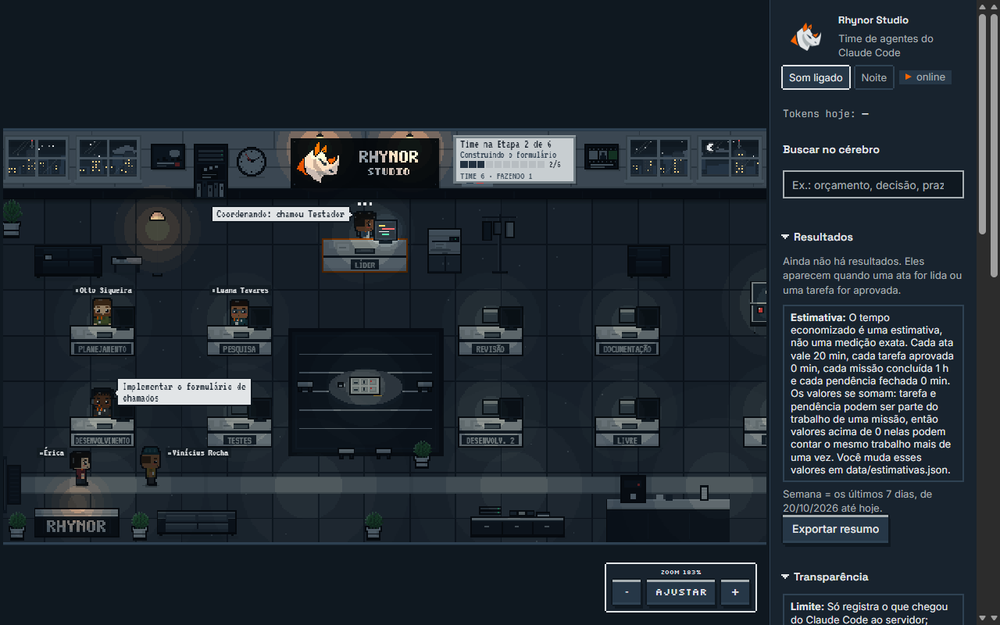

# Instalando o AG Pocket em outro PC

Guia para quem não conhece o projeto. Tempo estimado: 10 a 15 minutos (a maior parte é download).

## 1. O que é o AG Pocket

Um escritório pixel art que mostra, em tempo real, o seu time de agentes do Claude Code trabalhando: cada agente é um **AGzinho** que senta na mesa, digita, pede ajuda e descansa. O `npm run setup` deixa o PC pronto: instala o time de agentes, os hooks, o comando `/time`, o Playwright e as skills, e monta o escritório.



## 2. Pré-requisitos

| O que | Versão | Link |
|---|---|---|
| Node.js (com npm) | 20 ou mais novo | https://nodejs.org |
| Git | qualquer recente | https://git-scm.com/downloads |
| Claude Code, **já logado** | recente | https://docs.claude.com/en/docs/claude-code/setup |
| Edge ou Chrome | qualquer recente | https://www.microsoft.com/edge · https://www.google.com/chrome |

Para conferir, num terminal novo: `node --version` (precisa mostrar v20 ou maior), `git --version` e `claude --version`. Rode `claude` uma vez e faça o login antes do setup.

## 3. Instalação

```bash
git clone https://github.com/PabloH-Fernandes/escritorio-ia.git
cd escritorio-ia
npm run setup
npm start
```

O `npm run setup` roda `npm install` sozinho. Ao fim, `npm start` sobe o escritório em http://127.0.0.1:4747. Abra uma sessão **nova** do Claude Code em qualquer projeto: o líder entra pela porta e, quando delegar, os outros chegam.

O setup é seguro para rodar de novo: o que já está em dia é pulado, e arquivos de configuração do Claude (`settings.json`, `CLAUDE.md`) ganham um backup `*.backup-*` antes de mudar.

### Opções (flags)

Com `npm run`, as flags vão **depois de um `--`**:

```bash
npm run setup -- --dry-run
npm run setup -- --completo --browser=chrome
```

| Flag | O que faz |
|---|---|
| `--dry-run` | Só mostra o que faria, sem escrever nada. Boa para o primeiro contato. |
| `--completo` | Instala também os **extras** (skills e plugins de terceiros, ver seção 5). |
| `--sem-plugins` | Pula marketplaces, plugins e skills. Útil em rede restrita. |
| `--browser=NAV` | Navegador do Playwright: `chrome`, `msedge`, `firefox` ou `webkit`. Padrão: `msedge` no Windows e `chrome` nos outros sistemas. |
| `--check` | Só confere (o mesmo que `npm run setup:check`). |

## 4. Como conferir

```bash
npm run setup:check
```

Não instala nem escreve nada: lista o que está em dia e o que falta. Dentro do Claude Code, `/agents` deve listar os 6 agentes (planejador, pesquisador, dev, testador, revisor, documentador) e `/time` deve existir como comando.

## 5. O que é instalado

O setup roda os comandos oficiais do `claude` no escopo de **usuário** (vale para todos os projetos). A lista vem de `setup/skills.json`.

Além do catálogo abaixo, o setup também faz estas coisas:

| O quê | Onde fica |
|---|---|
| 6 agentes do time | `~/.claude/agents/` |
| Hooks que mandam os eventos ao escritório | `~/.claude/settings.json` |
| `CLAUDE_CODE_ENABLE_TODO_TOOLS=1` (lista de tarefas, usada pelo quadro de etapas) | `~/.claude/settings.json`, em `env` |
| Bloco do time (`team/CLAUDE-time.md`) entre `<!-- ag-pocket:inicio -->` e `<!-- ag-pocket:fim -->` | `~/.claude/CLAUDE.md` |
| Bloco de memória (`team/CLAUDE-memoria.md`) entre `<!-- ag-pocket:memoria:inicio -->` e `<!-- ag-pocket:memoria:fim -->`. Cópias antigas sem marcadores saem só se o setup reconhecer todas as linhas (com backup) | `~/.claude/CLAUDE.md` |
| Comando `/time` | `~/.claude/commands/time.md` |
| Elenco inicial, copiado de `data/agzinhos.example.json` (se ainda não existir) | `data/agzinhos.json` |
| Build do escritório | `web/dist/` |

### Essenciais (sempre instalados)

| Item | Tipo | Para que serve | Onde fica |
|---|---|---|---|
| `claude-code-plugins` | marketplace | Catálogo oficial de plugins do Claude Code (`anthropics/claude-code`) | `~/.claude/plugins/` |
| `frontend-design` | plugin | Ajuda o Claude a criar interfaces bonitas e diferentes do padrão genérico | `~/.claude/plugins/` |
| `anthropic-agent-skills` | marketplace | Catálogo de skills oficiais da Anthropic (`anthropics/skills`) | `~/.claude/plugins/` |
| `example-skills` | plugin | Skills de exemplo da Anthropic (theme-factory, webapp-testing e outras) | `~/.claude/plugins/` |
| `playwright` | MCP | Deixa o testador e o revisor abrirem o site num navegador de verdade | `~/.claude.json` (escopo de usuário) |
| `web-design-guidelines` | skill | Revisa interface contra boas práticas de design e acessibilidade | `~/.claude/skills/` |
| `brainstorming` | skill | Ajuda a explorar a ideia antes de sair implementando | `~/.claude/skills/` |
| `webapp-testing` | skill | Plano B do testador: scripts Playwright para testar sites | `~/.claude/skills/` |
| `find-skills` | skill | Ajuda a achar e instalar outras skills | `~/.claude/skills/` |

### Extras (só com `--completo`)

> **Atenção:** os extras são de **terceiros** e rodam com as suas permissões (podem ler arquivos, rodar comandos e acessar a rede). Os de geração de imagem chamam um serviço externo. Revise cada um antes de instalar.

| Item | Tipo | Para que serve | Onde fica |
|---|---|---|---|
| `superpowers` | plugin (do marketplace `claude-plugins-official`, que o setup não adiciona; para remover: `claude plugin uninstall superpowers@claude-plugins-official`) | Pacote de fluxos de trabalho (planejar, depurar, revisar) | `~/.claude/plugins/` |
| `agent-browser` | skill | Controla um navegador pela linha de comando | `~/.claude/skills/` |
| `grill-me` | skill | O Claude te questiona até a ideia ficar clara | `~/.claude/skills/` |
| `copywriting` | skill | Escrita de textos de marketing | `~/.claude/skills/` |
| `nano-banana-2` | skill | Geração de imagens com IA (chama serviço externo) | `~/.claude/skills/` |
| `ai-image-generation` | skill | Geração de imagens com IA (chama serviço externo) | `~/.claude/skills/` |
| `remotion-motion-graphics` | skill (manual) | Vídeos e animações com Remotion. O setup só imprime a instrução: copie a pasta da skill de `haidrrrry/claude-remotion-skill` para `~/.claude/skills/` | `~/.claude/skills/` |
| `karpathy-skills` | marketplace (repo `forrestchang/andrej-karpathy-skills`) | Diretrizes de comportamento para o Claude errar menos ao programar | `~/.claude/plugins/` |
| `context-engineering-marketplace` | marketplace (repo `muratcankoylan/Agent-Skills-for-Context-Engineering`) | Skills de engenharia de contexto para agentes | `~/.claude/plugins/` |

## 6. O que NÃO vai pelo git (e como levar)

O `.gitignore` deixa de fora:

| Caminho | O que é | Como levar para o outro PC |
|---|---|---|
| `data/agzinhos.json` | Seu elenco personalizado (nomes, roupas, textos) | Copie o arquivo para a pasta `data/` do novo PC. Sem ele, vale o elenco de exemplo. |
| `data/escritorio.json` e `data/eventos/` | Estado do escritório e gravação de eventos (têm caminhos e prompts da sua máquina) | Não leve. Não compartilhe. |
| `referencias/` | Material de referência (logos, manual de marca etc.) | Copie à mão, por um canal que a empresa aprove. |
| `prints/` | Prints de conferência de quem desenvolveu | Opcional; não é necessário para rodar. |
| `node_modules/` e `web/dist/` | Gerados pelo `npm install` e pelo build | O setup recria. |

## 7. Problemas comuns

**`npm` ou `node` não é reconhecido.** O Node não está no PATH. Reinstale marcando a opção de adicionar ao PATH e **abra um terminal novo**.

**PowerShell diz que a execução de scripts está desabilitada** (erro de ExecutionPolicy ao rodar `npm`). Libere só para o seu usuário:

```powershell
Set-ExecutionPolicy -Scope CurrentUser RemoteSigned
```

**Erro de certificado (rede com proxy)**, como `UNABLE_TO_GET_ISSUER_CERT_LOCALLY` ou `self-signed certificate in certificate chain`. Peça ao Node para usar os certificados do Windows e rode o setup de novo:

```powershell
$env:NODE_OPTIONS="--use-system-ca"; npm run setup
```
```bash
NODE_OPTIONS=--use-system-ca npm run setup
```

**Nunca desligue a verificação SSL** (`NODE_TLS_REJECT_UNAUTHORIZED=0`, `strict-ssl false`, `--insecure`). Isso abre a porta para interceptação. Se a rede bloquear mesmo assim, fale com a TI ou use `--sem-plugins`.

**OneDrive travando arquivos** (erros de `EBUSY`, `EPERM`, `npm install` lento ou que não termina). Clone para uma pasta **fora do OneDrive**, por exemplo `C:\Users\<voce>\dev`, e rode o setup de lá.

**Playwright não abre o navegador.** Confira se o Edge ou o Chrome está instalado. Para outro navegador, remova o servidor e rode o setup de novo com a flag:

```bash
claude mcp remove playwright --scope user
npm run setup -- --browser=chrome
```

**Os comandos `claude` demoram e dão timeout** (PC lento, antivírus). O limite padrão é 300 segundos por item. Aumente:

```powershell
$env:AG_SETUP_TIMEOUT_S="600"; npm run setup
```

Se um item estourar o tempo, o setup avisa "tempo esgotado" e mostra o comando manual. No Windows, o processo filho (npx/node) pode continuar rodando em segundo plano mesmo assim; confira no Gerenciador de Tarefas antes de tentar de novo.

Se algum item falhar, o setup mostra o comando manual equivalente e segue com os outros. Rodar de novo só refaz o que faltou.

## 8. Como desinstalar

1. Hooks: `npm run uninstall-hooks` (tira só as entradas do AG Pocket do `~/.claude/settings.json`).
2. Agentes: apague de `~/.claude/agents/` os 6 arquivos `planejador.md`, `pesquisador.md`, `dev.md`, `testador.md`, `revisor.md` e `documentador.md`.
3. Comando: apague `~/.claude/commands/time.md`.
4. Blocos do time e de memória: abra `~/.claude/CLAUDE.md` e apague tudo entre `<!-- ag-pocket:inicio -->` e `<!-- ag-pocket:fim -->` e entre `<!-- ag-pocket:memoria:inicio -->` e `<!-- ag-pocket:memoria:fim -->`, inclusive as linhas de marcador.
5. Variável de tarefas (opcional): remova `CLAUDE_CODE_ENABLE_TODO_TOOLS` de `env` no `~/.claude/settings.json`.
6. Playwright: `claude mcp remove playwright --scope user`.
7. Plugins e marketplaces, se quiser: `claude plugin uninstall <plugin>` e `claude plugin marketplace remove <nome>` (nomes na seção 5; o `superpowers` sai com `claude plugin uninstall superpowers@claude-plugins-official`, e os marketplaces extras se chamam `karpathy-skills` e `context-engineering-marketplace`), ou use `/plugin` dentro do Claude Code. Skills avulsas ficam em `~/.claude/skills/` (e `~/.agents/skills/`): apague a pasta da skill.
8. Por fim, apague a pasta do projeto.

## 9. Avisos

- **O repositório é privado.** Ele guarda a identidade visual da empresa (logo e cores). Não torne público nem compartilhe fora da empresa.
- **Antes de usar com dados da empresa**, confirme com a TI/segurança que os hooks, o servidor local e os plugins de terceiros são permitidos. Os hooks mandam cada evento do Claude Code (comandos, caminhos de arquivos, trechos de prompt) para o servidor local, que escuta só em `127.0.0.1`. O arquivo `data/escritorio.json` guarda esses caminhos e, em pasta sincronizada (OneDrive), sobe junto.
- **Os extras são de terceiros e rodam com as suas permissões.** Use `--completo` só depois de revisar a lista da seção 5.
- **O bloco de memória (Obsidian) não tem caminho pessoal.** O `team/CLAUDE-memoria.md` manda ler o vault da variável `AGPOCKET_VAULT` (`env` do `~/.claude/settings.json`), que o passo do vault grava.
